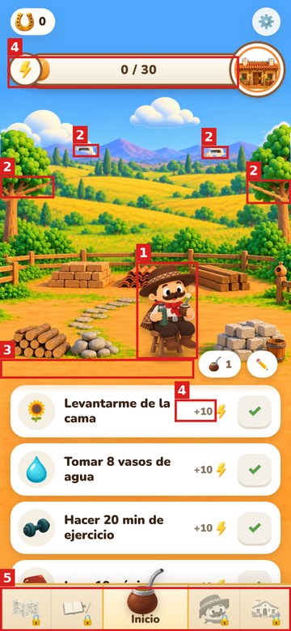
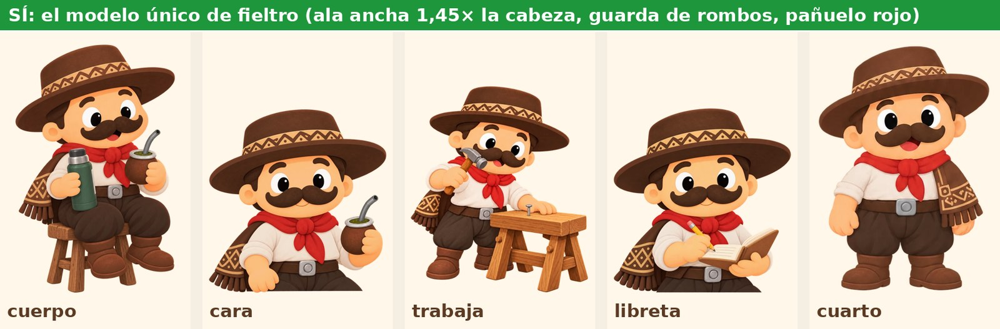
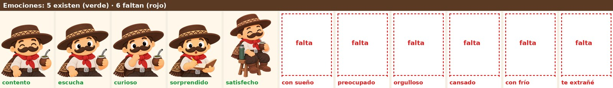
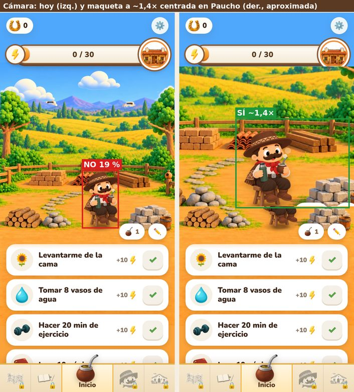
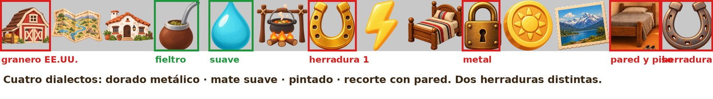
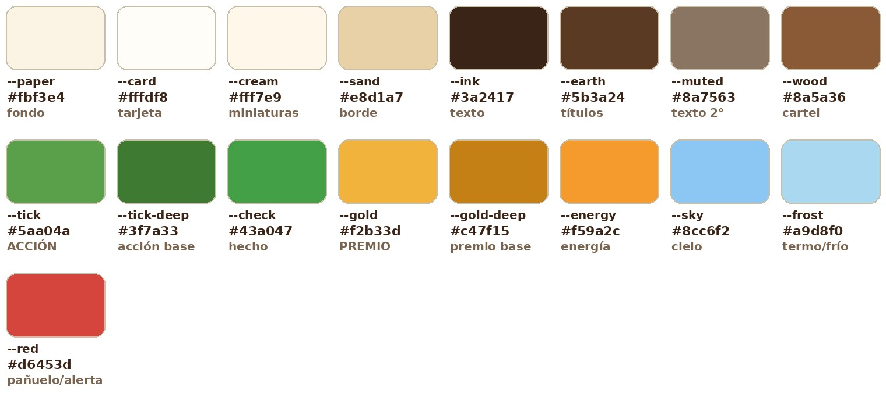
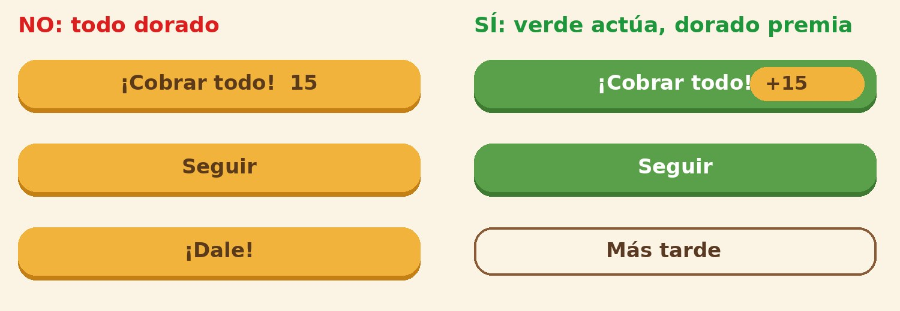

# Guía visual de Gauchito

> Estado: guía viva · Aplica a toda funcionalidad nueva desde el lanzamiento suave · Se apoya en: 12 (un solo estilo, aprobado), 13 (cámara más cerca, aprobado), 14 (Paucho se mueve), 15 (ceremonias, festejo y sonido)

Esta guía dice cómo tiene que verse, moverse y sonar Gauchito, qué está mal hoy y qué se revisa antes de lanzar algo nuevo. Cada regla tiene un ID (`PJ-03`) para citarla en una revisión. Las capturas son de la rama `areas` a 390×844; los recuadros rojos marcan lo que hay que corregir y los verdes, lo que hay que copiar.

Cómo usarla: al diseñar, leé el capítulo que toca. Al lanzar, recorré la checklist del final con los ID. Si una regla choca con una decisión del dueño, gana la decisión y la regla se corrige acá.

---

## 1. Principios

**P1 · Un solo Paucho, idéntico en todas partes.** El Paucho de fieltro (`mate_*`, sombrero de ala ancha) es el único modelo. Por qué: al lado de Finch en la tienda lo que delata a una app chica no es la calidad de cada pieza sino la mezcla (plan). Se lo aprendemos a Duolingo: Duo es el mismo búho en la app, los avisos, el ícono, las tarjetas y las redes. Con dos Pauchos en la misma ceremonia, el jugador no sabe cuál es «su» compañero.

**P2 · Paucho primero, la interfaz después.** Lo que se mira en Inicio es Paucho, no la barra ni las tarjetas. Por qué: el vínculo con un compañero se arma leyéndole la cara, y una cara de 40 px no se lee (doc 13). Se lo aprendemos a Finch, donde el pajarito ocupa el tercio central de Inicio y todo lo demás se ordena alrededor.

**P3 · Lo diario es corto; lo raro se siente raro.** Un festejo que se repite todos los días dura ≤ 3 s y no pide toques; la ceremonia grande queda para lo que pasa una vez. Por qué: si todo festeja igual, nada festeja. Se lo aprendemos a Royal Match: el fin de nivel normal es un golpe de 2 s y el cofre de hito tiene su propia puesta en escena. Duolingo hace lo mismo con la extensión de racha diaria (corta) frente a los hitos de 7, 30 y 365 días (largos).

**P4 · El color dice qué hacer y qué ganaste.** Verde = la acción principal; dorado = premio (herraduras, cofres, hitos). Nada más es dorado. Por qué: el color es la señal más rápida de la pantalla; si el dorado está en todos los botones, el premio pierde valor (plan). Se lo aprendemos a Duolingo (botón verde único, oro solo para logros) y a Royal Match (botón verde de jugar, monedas y cofres en oro).

**P5 · Un mundo de fieltro con una sola luz.** Todo objeto (íconos, prendas, animalitos, escenas) es del mismo material, con la luz arriba a la izquierda a 45°, sombra propia suave y sin brillo metálico. Por qué: un ícono metálico al lado de uno de fieltro se lee como un parche. Se lo aprendemos a Homescapes y a Animal Crossing: hasta el ícono más chico parece un objeto del mismo mundo.

**P6 · Todo se mueve con intención y con peso.** Cada movimiento tiene anticipación, acción y asentamiento, con curvas distintas para entrar, salir y festejar. Por qué: hoy todo rebota con la misma curva (22 usos) y Paucho se teletransporta; así nada tiene peso (plan). Se lo aprendemos al rey de Royal Match, que actúa con todo el cuerpo, y al pajarito de Finch, que camina, se duerme y se estira.

**P7 · Amable siempre, también cuando no hiciste nada.** Lo visual nunca reta: ni rojo de alarma, ni Paucho llorando por tu ausencia, ni fuego que se apaga. Los estados bajos de Paucho hablan de *su* día (tiene sueño, hace frío), nunca de lo que no hiciste. Por qué: es una app de bienestar con público 18+ y tiendas que miran esto; la culpa sube bajas de avisos. Se lo aprendemos a Finch, que trata el día salteado sin castigo.

---

## 2. Auditoría de hoy

Lo que sigue sale del capítulo «Arte y animación» del plan, verificado sobre las capturas a 390×844, el arte de `app/public/a/` y `index.css` de la rama `areas`. Severidad: **A** = se ve en la primera sesión o delata la app en la tienda; **B** = se ve todos los días; **C** = pulido.

*Inicio, día 0. 1: Paucho ocupa ~19 % del ancho y su cara no se lee. 2: cicatrices de recorte (restos blancos sobre las sierras, ramas cortadas en seco donde se pegan las capas de árbol). 3: franja de tierra lisa. 4: la energía (+10 ⚡) y la barra en dorado-naranja, el mismo tono que los premios. 5: pestañas bloqueadas en gris con candado; cuatro dialectos de ícono en una sola barra.*

| # | Problema | Evidencia | Sev. | Arreglo | Doc |
|---|---|---|---|---|---|
| 1 | **Dos Pauchos.** El del artista (`g_*`, sombrero chico, sombreado plano) y el de fieltro (`mate_*`, ala ancha) conviven en la misma ceremonia y en la barra de pestañas | `img/no-dos-pauchos.jpg`; Reveal.tsx:186 (`g_jump` y 1,7 s después `mate_b4`); `g_avatar` en pestaña Paucho (`img/hoy-pestana-paucho.jpg`) | A | Rehacer las 6 `g_*` visibles en fieltro; avatar recortado de `mate_b2` | 12 |
| 2 | **Paucho chico.** ~75 px de ancho (19 %) y cara de ~40 px en Inicio; la mitad inferior del arte es tierra lisa | `img/hoy-inicio.jpg`; AreaScene.tsx (`width = size.w`) | A | Cámara 1,40× centrada en Paucho (doc 13); objetivo ≥ 28 % en V1 y ~35 % con pose de reposo nueva (PJ-05) | 13 |
| 3 | **Cicatrices en la primera escena.** Placas verdes planas sobre los dos troncos y hueco blanco en las sierras de `area1_scene_0` (las etapas 1–3 lo heredan) | `img/hoy-escena-cicatrices.jpg` | A | Retocar el plano limpio y reimportar `area1_scene_0..3` | 12 |
| 4 | **Cuatro dialectos de íconos** y dos herraduras distintas (dorada metálica `ui_herradura`, bronce en la tienda) | `img/no-iconos-mezclados.jpg` | A | Una hoja de 32 íconos de fieltro, misma luz (IC-01) | 12 |
| 5 | **Fuera de modelo:** `nav_rancho` es un granero rojo norteamericano; el candado del Mapa es metal fotográfico | `img/no-iconos-mezclados.jpg`, `img/hoy-mapa-ajustes.jpg` | A | Estancia con tranquera; candado de fieltro y madera | 12 |
| 6 | **Dorado para todo.** 40 usos de `--gold*` contra 22 de verde; botones principales dorados («¡A ver!», «¡Cobrar todo!», «Seguir», «¡Dale!»), barras de progreso doradas | `img/hoy-dorado-en-todo.jpg`; `index.css` | A | Botón principal verde; dorado solo premios (CO-02) | 15 |
| 7 | **Una sola curva para todo:** `cubic-bezier(0.3, 1.6, 0.5, 1)` 22 veces, y 6 variantes del mismo rebote (45 usos en total) | `index.css` | B | 5 curvas con nombre en tokens (AN-01) | 14 |
| 8 | **Títere de diapositivas.** Martilla con 3 poses (2 cuadros/s reales), respira escalando el bitmap, habla alternando 2 imágenes cada 130 ms sin relación con el texto, nunca camina | AreaScene.tsx, PauchoTalk.tsx | B | Sprites a 12 fps; prueba de 2 días con el martillo | 14 |
| 9 | **Siempre contento.** 5 emociones de cuerpo entero; faltan sueño, preocupación, orgullo, cansancio, frío y «te extrañé» | `mate_*`, `libreta_*`; `img/si-emociones.jpg` | B | 6 expresiones nuevas en la hoja de modelo (PJ-07) | 12 |
| 10 | **La barra llena cobra peaje:** cinco tiempos con texto y dos toques, todos los días | EnergyFull / DayLoop.tsx | B | Ceremonia completa el primer día; después ≤ 3 s sin toques (CE-02) | 15 |
| 11 | **Sonido sintetizado.** Todos los efectos son osciladores de Web Audio; es lo que más barato suena | sound.ts:1-7 | B | Sonidos grabados y voz en sílabas (SO-01) | 15 |
| 12 | **Emojis del sistema como íconos:** 🎵🔔📳 en Ajustes, 🔥 y corazones en la pestaña Paucho, 🧉 en globos, 🏡🐶 en Recuerdos. Se ven distinto en iPhone y en Android | `img/hoy-mapa-ajustes.jpg`, `img/hoy-pestana-paucho.jpg` | B | Íconos de la hoja; emoji solo dentro de texto de Paucho y nunca como ícono (IC-06) | 12 |
| 13 | **La racha se dibuja con fuego** (🔥) en la pestaña Paucho, aunque la racha es «el mate de la mañana» | `img/hoy-pestana-paucho.jpg` | B | Mate humeante como símbolo único de racha (IC-07) | 08 |
| 14 | **La ropa no se ve.** «Su ropa» es una lista de chips de texto marrón; 4 de 6 prendas no tienen capa puesta (plan) | `img/hoy-pestana-paucho.jpg`; shop.ts:43-46 | B | Miniatura de cada prenda y Paucho vestido en la pestaña (VE-04) | 12, 14 |
| 15 | **Miniaturas de la tienda con pared y piso** (`thumb_*`): un cuarto adentro de una tarjeta | `img/hoy-casita.jpg` | B | Objeto solo sobre `--cream` (IC-04) | 12 |
| 16 | **Casita vacía.** Paucho mide ~55 px de ancho; 40 % de la escena es piso naranja liso | `img/hoy-casita.jpg` | C | Encuadre del cuarto más cerca y objetos de piso (ES-05) | 13 |
| 17 | **Contraste bajo en la racha.** «días de racha» y letras de los días en naranja `#f59a2c` sobre crema: ~2,2:1 | `img/si-racha-mate.jpg` | B | Texto de racha en `--earth`; naranja solo en el número grande (AC-01) | 08 |
| 18 | **Tipografía sin escala:** 26 tamaños distintos (12 a 42 px, con 12,5, 13,5 y 14,5) y peso 900 en 116 reglas | `index.css` | C | 7 tamaños con nombre (TI-01) | — |
| 19 | **Memoria a medir.** 313 imágenes en 12,5 MB, pero cada escena de 1024×1536 ocupa ~6,3 MB decodificada; 124 `@keyframes` | `index.css`, `a/` | B | Presupuesto de memoria y prueba en Android de 3–4 GB (RE-01) | 13, 14 |
| 20 | **Reseñas inventadas** de 5 estrellas que elogian «aventuras» e «historias» en «Armando tus metas» | PlanScreens.tsx:12-19 | A | Sacarlas antes de publicar (MT-05) | 11 |
| 21 | **Reducir movimiento cubierto a medias:** 2 bloques `prefers-reduced-motion` en 7.853 líneas de CSS | `index.css:1540, 3189`; DayOne.tsx:143 | B | Variante quieta para cada animación de más de 400 ms (AC-04) | 14 |

**Lo que está bien y hay que cuidar.** La escena de la racha (`img/si-racha-mate.jpg`) es la mejor pantalla de la app: Paucho de fieltro grande, una sola idea, cielo que amanece. El plano medio de «¡Volviste!» (`done1`) también: Paucho ocupa el 90 % del ancho y habla de cerca. La vida de ambiente (nubes, árboles, fogón, gallinas, veleta) está por encima del promedio indie (plan). Las reglas de esta guía salen en buena parte de generalizar esas pantallas.

---

## 3. Capítulos

Cada capítulo trae reglas con ID, specs, un bloque **SÍ / NO**, quién lo hace mejor y «Hoy en Gauchito». Las medidas en px son CSS a 390×844 salvo que diga «del arte».

### 3.1 Personaje (PJ)

Paucho es un pibe de campo dormilón y tierno, de fieltro, chibi de 2,6 cabezas. Todo lo que lo muestre sale de la hoja de modelo (doc 12).

| ID | Regla | Spec |
|---|---|---|
| PJ-01 | **Modelo único.** Todo Paucho nuevo se genera con la hoja de modelo y dos `mate_*` de referencia, y se compara contra `mate_b2_habla_cerrada` (cara) y `mate_a1_base` (cuerpo) | Juez separado; rechazo si cambia la forma del bigote, el ojo o el sombrero |
| PJ-02 | **Proporciones fijas** | 2,6 cabezas de alto; ala del sombrero = 1,45 × ancho de cabeza; guarda de 9 rombos crema sobre marrón; bigote en «manubrio» que tapa la boca de costado; ojos negros con 1 brillo arriba a la izquierda |
| PJ-03 | **Silueta legible en negro.** Cada pose se tiene que entender rellena de negro a 64 px de alto | Prueba de silueta en el control de calidad (§5) |
| PJ-04 | **Paleta del personaje** cerrada en 8 muestras | sombrero `#6b3f22`, guarda `#e9d3a8`, pañuelo `#d6453d`, camisa `#f6efe3`, poncho `#5b3a24` con guarda, bombacha `#4a2e1c`, botas `#7b4a2a`, piel `#f4c79a` (muestreadas de `mate_a1_base`, estimación ±5 %) |
| PJ-05 | **Tamaño en pantalla.** En Inicio Paucho ocupa ≥ 28 % del ancho y ≥ 170 px de alto en reposo (doc 13, V1). Meta V2: ~35 % del ancho con la pose de reposo de frente y brazos abiertos. En primeros planos (`PauchoTalk`, racha), ≥ 60 % del ancho | Hoy: 19 % y 123 px |
| PJ-06 | **Cara mínima** | ≥ 50 px de alto de cara en cualquier pantalla donde Paucho hable o reaccione; si no entra, se usa plano medio |
| PJ-07 | **Rango emocional.** Además de las 5 existentes (contento, escucha, curioso, sorprendido, «ahh»), se producen 6: con sueño, preocupado *por algo suyo*, orgulloso, cansado, con frío, «te extrañé» (abrazo, sin lágrimas) | Plano medio 1254×1254 con `_cerrada`/`_abierta`, como `mate_b*` |
| PJ-08 | **Estados bajos sin culpa.** Las caras bajas se usan para el día de Paucho (llovió, la obra cansa, siesta) y nunca junto a un texto sobre lo que el jugador no hizo | Revisión de texto + imagen juntas |
| PJ-09 | **Poses con intención.** Toda pose nueva dice una acción con todo el cuerpo (peso en una pierna, cabeza inclinada), no solo la cara | Rechazo si la pose es «parado de frente» con otra boca |
| PJ-10 | **Mira al jugador** al hablarle, y a la obra o al objeto cuando habla de eso | La mirada se decide en el guion de cada escena |
| PJ-11 | **Elenco sin próceres.** Mate, termo con calcomanías, perro, siesta, radio con cumbia, auriculares colgados del sombrero. Nada de facón, boleadoras, bandera ni discursos | Lista negra en el prompt base |
| PJ-12 | **Pies en el piso.** Cajas de pose de campo 906×990 con botas en y = 982,5 del arte | Diferencia ≤ 2 px a 390 de ancho (doc 12) |

**SÍ / NO**

- **SÍ:** el primer plano de «¡Volviste, Nacho!» (`done1`): Paucho llena el 90 % del ancho, saluda con la mano, mate en la otra, mira a cámara. Se lee la emoción desde un metro.
- **NO:** `g_jump` seguido de `mate_b4` en la misma revelación: dos sombreros, dos bigotes, dos sombreados en 1,7 s (`img/no-dos-pauchos.jpg`).
- **SÍ:** «Tengo un sueño… anoche la radio no paraba» con la cara de sueño.
- **NO:** cara triste con «Ayer no viniste».
- **NO:** una pose nueva que solo cambia la boca sobre el mismo cuerpo de frente.

**Quién lo hace mejor.** Duolingo: Duo es idéntico en app, avisos, ícono y redes, y cambia de ánimo según lo que hacés. Finch: el pajarito tiene estados de sueño, cansancio y alegría que acompañan tu día sin reprochar. Royal Match: el rey actúa con todo el cuerpo y se lo reconoce en silueta.

**Hoy en Gauchito.** Corregir: dos Pauchos (`g_idle`, `g_celebrate`, `g_wave`, `g_thumbs`, `g_jump`, `g_avatar` → fieltro); 19 % del ancho en Inicio; 6 emociones faltantes; `g_sad`, `g_sleep`, `g_surprised` existen pero en el estilo viejo y sin pantalla (se borran, doc 12). Cuidar: los planos medios `mate_b*` y la escena de la racha.

### 3.2 Mascotas y animalitos (MA)

Los animalitos son del mismo fieltro que Paucho y miden en cabezas de Paucho, no en píxeles sueltos. Hoy hay perro (Chicho, `perro_*` de fieltro y `dog_*` viejo), gato (`michi_*`) y gallinas de área.

| ID | Regla | Spec |
|---|---|---|
| MA-01 | **Mismo material y luz** que Paucho (P5) | Fieltro, luz arriba a la izquierda, sin contorno negro |
| MA-02 | **Escala relativa** | Perro sentado = 0,55 del alto de Paucho; carpincho echado = 0,45; hornero = 0,18; ñandú parado = 1,1; gallina = 0,30 |
| MA-03 | **Ojos simples**: dos puntos negros con brillo, como Paucho; sin iris de color | Rechazo de ojos realistas |
| MA-04 | **Set mínimo por animal**: parado, sentado/echado, dormido, feliz, + 1 gesto propio (el carpincho bosteza, el hornero lleva barro, el carancho roba algo) | 5 poses, ≤ 420×530 de caja |
| MA-05 | **Parpadeo** con capa `_ojos` como `perro_room_a_ojos` | cada 3–6 s, 120 ms cerrado |
| MA-06 | **Uno acompaña a Paucho en Inicio**; nunca más de 2 animales en primer plano | Sin tapar la cara de Paucho ni las tarjetas |
| MA-07 | **Sin ropa humana** en animales (nada de sombreritos); como mucho un collar o pañuelo atado | Lo distingue de lo infantil |
| MA-08 | **Nombre visible solo en la ficha**, no flotando sobre la escena | — |
| MA-09 | **Animales autóctonos tiernos, no peligrosos**: carpincho, hornero, ñandú, mulita, vizcacha, lechucita, yacaré con tereré (plan). El yacaré sin dientes a la vista | — |

**SÍ / NO**

- **SÍ:** `cucha_asoma_mira`: el perro asoma de la cucha y mira; una pose chica que cuenta algo.
- **NO:** `dog_sit` viejo (plano, otro perro) al lado de Paucho de fieltro todos los días desde el Área 2 (doc 12 lo rehace).
- **SÍ:** el carpincho dormido en la laguna, medio sumergido, con un pájaro encima.
- **NO:** un carpincho con gorra y anteojos de sol; un hornero del tamaño de Paucho.

**Quién lo hace mejor.** Finch: las micromascotas son objetos de colección chicos, del mismo estilo que el pajarito, y acompañan sin competir. Animal Crossing: cada animal tiene un gesto propio que lo vuelve reconocible.

**Hoy en Gauchito.** Corregir: `dog_sit` y `dog_sleep` del estilo viejo en el campo; en la Casita el perro mira para otro lado y queda en el piso vacío (`img/hoy-casita.jpg`). Cuidar: `perro_b*` y `michi_*`, que ya son del modelo.

### 3.3 Vestimenta y capas por pose (VE)

Una prenda que no se ve puesta no existe. Hoy 4 de 6 prendas no tienen capa (plan) y la pestaña Paucho las muestra como chips de texto.

| ID | Regla | Spec |
|---|---|---|
| VE-01 | **Tres lugares**: cabeza (sombrero, gorra, auriculares), cuello (pañuelo), cuerpo (poncho, chaleco) | Sin lugar de pies hasta tener esqueleto |
| VE-02 | **Una capa por pose visible** para cada prenda que se venda. Si no hay capa para una pose, esa pose usa la ropa base | Lista de poses × prendas en `shop.ts` (`WEAR`) |
| VE-03 | **Teñido con máscara** para variantes de color (doc 14, alternativa A) | 1 máscara por prenda y pose/ciclo, ≈ 20 KB (estimación) |
| VE-04 | **Se ve antes de comprarse**: la tienda muestra a Paucho con la prenda puesta, no la prenda sola | Vista previa en plano medio |
| VE-05 | **Silueta del sombrero intocable**: los sombreros nuevos conservan ala ancha ≥ 1,3 × cabeza; gorras y auriculares van sobre o colgados del sombrero | Paucho se reconoce por el sombrero |
| VE-06 | **Alineación al píxel** con la pose: misma caja y mismo origen que la pose base | Diferencia 0 px; se verifica superponiendo al 50 % |
| VE-07 | **Sin disfraz**: nada de trajes patrios, de próceres ni de marcas de otros | — |
| VE-08 | **Premium se ve premium sin dorado**: textura más rica (bordado, guarda doble), no brillo metálico | P4, P5 |

**SÍ / NO**

- **SÍ:** pañuelo celeste en `idle`, `celebrate` y `avatar` (`wear_panuelo_celeste_*`): la prenda acompaña al personaje en las tres poses.
- **NO:** «Su sombrero / Su pañuelo rojo / Su poncho» como botones de texto marrón (`img/hoy-pestana-paucho.jpg`, 4).
- **NO:** vender un poncho que en Inicio no aparece porque la pose de martillo no tiene capa.
- **SÍ:** si la pose no tiene capa, la tienda dice «Se luce en la casita y en tu perfil».

**Quién lo hace mejor.** Finch: la ropa se ve en el pajarito en todas las pantallas principales y en las fotos. Duolingo: los trajes de Duo en eventos son pocos y siempre se ven puestos.

**Hoy en Gauchito.** Corregir: la pestaña Paucho sin imagen de la ropa; capas solo para 2 pañuelos × 3 poses viejas (se rehacen sobre fieltro, doc 12); las poses de trabajo sin capa. Decidir con la prueba del doc 14 si se paga un esqueleto antes de pasar de 10 prendas.

### 3.4 Escenas, fondos y cámara (ES)

La escena es un escenario para Paucho, no un paisaje. Lo que importa va al centro, a la altura de la cara.

| ID | Regla | Spec |
|---|---|---|
| ES-01 | **Cámara de reposo 1,40×** centrada en los pies de Paucho, que caen 50 px sobre la fila de chips | Doc 13 (aprobado); transiciones de 500–900 ms con `--ease-cam` |
| ES-02 | **Sin cicatrices**: ninguna placa, halo, recorte ni hueco visible al 200 % | Revisión al 200 % sobre cada etapa |
| ES-03 | **Tres planos de profundidad**: cielo y sierras (fondo), campo (medio), patio con Paucho (frente). El fondo baja saturación un 20–30 % y sube valor para separar | Medido con cuentagotas |
| ES-04 | **Nada liso más de 60 px** a la altura del personaje: pasto, piedras, una gallina | V2 del doc 13 con 3–4 sprites de primer plano |
| ES-05 | **Interiores (Casita)** con el mismo criterio: Paucho ≥ 25 % del ancho, el piso con alfombra u objetos | Hoy ~14 % |
| ES-06 | **Formato del arte**: escenas 1024×1536 webp; sin bordes visibles en ningún encuadre; arriba degradado de cielo, abajo color `ground` | Doc 13 |
| ES-07 | **Hora del día** solo en escenas de ceremonia (la racha amanece); Inicio queda de día | Evita relojes que mientan |
| ES-08 | **Encuadre por momento**: reposo, obra, revelación, salida (doc 13). Nunca dos movimientos de cámara encadenados | — |
| ES-09 | **Velo detrás de hojas** (Ajustes, globos grandes): desenfoque de 8–12 px y oscurecido 20 %, como hoy | Mantener |

**SÍ / NO**

- **SÍ:** la racha: cielo, campo y Paucho grande sobre el banquito, una sola idea por pantalla (`img/si-racha-mate.jpg`).
- **NO:** Inicio de hoy: Paucho de 75 px rodeado de pilas de material y tierra lisa (`img/hoy-inicio.jpg`).
- **NO:** ramas cortadas en seco donde se pega la capa del árbol y restos blancos sobre las sierras (`img/hoy-escena-cicatrices.jpg`).

**Quién lo hace mejor.** Finch: el pajarito ocupa el tercio central y el fondo acompaña. Homescapes: la cámara se acerca a la habitación que se renueva y vuelve al personaje después.

**Hoy en Gauchito.** Corregir: cámara a 1×; cicatrices de `area1_scene_0..3`; piso vacío de la Casita; Área 3 son carteles de madera provisorios (plan). Cuidar: la vida de ambiente.

### 3.5 Íconos (IC)

Un ícono es un objeto chico del mundo de Paucho, hecho de lo mismo y con la misma luz.

| ID | Regla | Spec |
|---|---|---|
| IC-01 | **Una sola hoja** por tanda: 4096×2048, grilla 8×4, celda 512, margen 48, fondo magenta `#FF00FF` | Doc 12 |
| IC-02 | **Salida** 256×256 webp ≤ 20 KB; se muestra a 24, 32, 44 o 64 px | 4 tamaños, ninguno más |
| IC-03 | **Mismo tamaño aparente**: el objeto ocupa 80 % de la celda en su lado mayor; objetos redondos 75 % | Se mide en la hoja |
| IC-04 | **Sin escenario**: el objeto solo, sin pared, piso ni marco. Las miniaturas de tienda van sobre `--cream` | Hoy `thumb_*` traen pared y piso |
| IC-05 | **Vista de tres cuartos** desde arriba a 15–20°, luz arriba a la izquierda, sombra propia suave, sin sombra arrojada, sin brillo metálico | P5 |
| IC-06 | **Emoji nunca como ícono.** Se ven distinto en iOS y Android y rompen el estilo. Solo pueden aparecer dentro de una frase de Paucho, como máximo uno | Hoy: 🎵🔔📳🔥🏡🐶🧉 |
| IC-07 | **Un significado, un ícono.** Racha = mate humeante; moneda = herradura (una sola); energía = rayo de fieltro amarillo; bloqueado = candado de madera y cuero | Hoy hay 2 herraduras y la racha usa 🔥 |
| IC-08 | **Pestañas**: 5 íconos de la misma hoja, 32 px, etiqueta siempre visible en 11–12 px; activa con fondo `--nav-on-*` y etiqueta en `--ink` | Hoy la etiqueta solo aparece en la activa |
| IC-09 | **Bloqueado** = el ícono en su color al 45 % de opacidad + candado chico (16 px) en la esquina inferior derecha; nunca gris total | Gris total se lee como roto |
| IC-10 | **Aviso** (insignia roja con número): 18 px, `--red`, borde 2 px `--card`, arriba a la derecha sin tapar más del 25 % del ícono | — |
| IC-11 | **Fuera de modelo prohibido**: nada que no exista en el campo argentino (granero rojo con techo quebrado, silo de chapa) | Revisión cultural |

**SÍ / NO**

- **SÍ:** `habit_mate` y `habit_agua`: suaves, del mismo material, sin marco.
- **NO:** `nav_rancho` (granero norteamericano), `ui_candado` y `ui_herradura` metálicos, `thumb_cama_1` con pared y piso, y una segunda herradura de bronce.
- **NO:** «🔥 5 días de racha».
- **SÍ:** mate humeante de 32 px al lado de «5 días de racha».

**Quién lo hace mejor.** Duolingo: un solo set de íconos con la misma forma redondeada en toda la app. Royal Match: monedas, estrellas y cofres son siempre el mismo objeto, del mismo material, en cualquier tamaño.

**Hoy en Gauchito.** Corregir: cuatro dialectos, dos herraduras, granero, candado de metal, emojis en Ajustes, Recuerdos y pestaña Paucho, `thumb_*` con escenario, pestañas sin etiqueta. Todo entra en la hoja de 32 del doc 12.

### 3.6 Color (CO)

Pocos colores, cada uno con un trabajo. La paleta sale de `app/src/index.css`.

| Rol | Token | Hex | Uso |
|---|---|---|---|
| Fondo | `--paper` / `--backdrop` | `#fbf3e4` / `#e9dcc5` | Pantallas y detrás de hojas |
| Tarjeta | `--card` / `--surface` | `#fffdf8` / `#ffffff` | Tarjetas, globos |
| Miniaturas | `--cream` | `#fff7e9` | Fondo de íconos y tienda |
| Texto | `--ink` | `#3a2417` | Todo texto de lectura |
| Título | `--earth` | `#5b3a24` | Títulos, botones secundarios |
| Texto 2° | `--muted` | `#8a7563` | Ayudas (solo ≥ 14 px) |
| Madera | `--wood` / `--wood-deep` | `#8a5a36` / `#6e452a` | Carteles de título |
| **Acción** | `--tick` / `--tick-deep` | `#5aa04a` / `#3f7a33` | **Botón principal**, check |
| Hecho | `--check` | `#43a047` | Estado «hecho» |
| **Premio** | `--gold` / `--gold-deep` | `#f2b33d` / `#c47f15` | **Solo** herraduras, cofres, hitos |
| Energía | `--energy` | `#f59a2c` | Barra de energía |
| Cielo / frío | `--sky` / `--frost` | `#8cc6f2` / `#a9d8f0` | Escenas, termo |
| Rojo | `--red` | `#d6453d` | Pañuelo, insignias; nunca alarma |

| ID | Regla | Spec |
|---|---|---|
| CO-01 | **Verde = acción principal.** Un solo botón verde por pantalla | `--tick` arriba, `--tick-deep` como base de 6 px; texto blanco 18 px peso 900 |
| CO-02 | **Dorado = premio.** Herraduras, cofres, hitos de racha, el brillo de la revelación. Nunca botones de navegar ni barras de progreso de tareas | Hoy 40 usos de `--gold*` |
| CO-03 | **Energía naranja, separada del dorado**: la barra usa `--energy`; el «+5 ⚡» de la tarjeta, `--earth` con el rayo de color | Que «+energía» no se confunda con «+herraduras» |
| CO-04 | **Secundario** = contorno `--wood` 2 px o texto `--earth` sin fondo | — |
| CO-05 | **Rojo nunca para estados del jugador** (racha en riesgo, hábito no hecho) | P7 |
| CO-06 | **Contraste**: texto ≥ 4,5:1, texto ≥ 24 px o 19 px negrita ≥ 3:1 | Ver AC-01 |
| CO-07 | **Tokens, no hex sueltos.** Todo color nuevo entra a `:root` con nombre y al sistema de diseño | Revisión de código |
| CO-08 | **Modo oscuro**: fuera de alcance; la app fuerza claro. Se revisa con escala | — |

**SÍ / NO**

- **SÍ:** «¡Cobrar todo!» en verde con una pastilla dorada «+15» a la derecha: el verde dice qué tocar, el dorado dice qué ganás.
- **NO:** «¡A ver!», «Seguir», «¡Dale!» y «¡Cobrar todo!» en el mismo dorado que las herraduras (`img/hoy-dorado-en-todo.jpg`).
- **NO:** borde dorado alrededor de la tarjeta del área en curso: «en curso» no es un premio; va con borde `--tick`.

**Quién lo hace mejor.** Duolingo: verde para continuar, dorado y violeta para logros y premium. Royal Match: verde para jugar, oro para monedas y cofres.

**Hoy en Gauchito.** Corregir: todos los botones principales y las barras de progreso de encargos y racha en dorado; el «+10 ⚡» en dorado-naranja; borde dorado en el Mapa.

### 3.7 Tipografía y carteles (TI)

Una familia (Nunito), siete tamaños, y los títulos importantes en cartel de madera.

| ID | Regla | Spec |
|---|---|---|
| TI-01 | **Escala con nombre** (tokens `--fs-*`) | `xs` 12 · `sm` 14 · `md` 16 · `lg` 18 · `xl` 22 · `2xl` 28 · `hero` 40–72 (números grandes) |
| TI-02 | **Pesos**: 700 texto, 800 etiquetas, 900 títulos y botones | Hoy 900 en 116 reglas; se reserva |
| TI-03 | **Interlineado** 1,3 en texto, 1,1 en títulos | — |
| TI-04 | **Títulos de pantalla en cartel de madera** (decisión tomada): tabla `--wood` con veta, clavos en las puntas, texto `--cream` 22 px peso 900 con sombra interior 1 px `--wood-deep` | Alto 48 px; ancho al texto + 32 px |
| TI-05 | **Cartel solo para títulos** de pantalla y de ceremonia; nunca para botones ni tarjetas | Si todo es cartel, nada es título |
| TI-06 | **Números grandes** (racha, herraduras ganadas) en `hero`, con contorno o sombra de 2 px para leerse sobre arte | Ej.: el «5» de la racha |
| TI-07 | **Mínimo 12 px** en cualquier texto; 14 px para texto que hay que leer (no solo reconocer) | Hoy hay 12,5 / 13,5 / 14,5 |
| TI-08 | **Globos de Paucho**: 16 px, peso 800, `--ink` sobre `--bubble`, máximo 3 líneas y ~90 caracteres | Si no entra, son dos globos |
| TI-09 | **Truncado**: nunca se corta un nombre de hábito; baja a 2 líneas y después a 14 px | Hoy «Cajón man…» en la tienda |

**SÍ / NO**

- **SÍ:** «5» de la racha en 72 px con «días de racha» en `--earth` 22 px debajo.
- **NO:** «días de racha» en el mismo naranja del número sobre crema (2,2:1).
- **SÍ:** «El galpón» en cartel de madera al abrir la revelación.
- **NO:** cartel de madera en el botón «¡Cobrar todo!».

**Quién lo hace mejor.** Duolingo: una sola familia redondeada con pocos tamaños muy marcados. Homescapes y Royal Match: títulos de evento en carteles con material del mundo.

**Hoy en Gauchito.** Corregir: 26 tamaños; tres tamaños con medio píxel; títulos sin cartel; truncados en la tienda.
